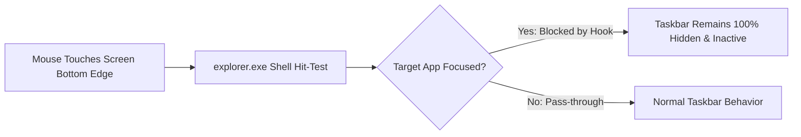

<div align="center">

# 🪟 Windows 11 App-Specific Taskbar Fixer
### *Zero-Latency Taskbar Suppression & True Fullscreen Work Area for Windows 11*

[](https://windhawk.net/)
[](https://www.microsoft.com/windows)
[](https://github.com/Dszae/taskbar-fixer)
[](https://github.com/Dszae/taskbar-fixer)
[](LICENSE)

<p align="center">
  <b>Hides the Windows 11 taskbar and strictly blocks accidental hover/edge reveal while your chosen applications are running or focused.</b><br>
  No more taskbars popping up over your DaVinci Resolve timeline, FL Studio controls, or Photoshop scrollbars!
</p>

[Quick Start](#-quick-start-guide) •
[Features](#-key-features) •
[Presets](#-presets-for-creators--pros) •
[How It Works](#-how-it-works-under-the-hood) •
[Comparison](#-comparison) •
[Troubleshooting](docs/TROUBLESHOOTING.md)

---

</div>

## 💥 The Problem

If you work in creative, production, or gaming software on Windows 11:
- **Video Editors (DaVinci Resolve, Premiere Pro):** The timeline playhead, zoom bars, and audio tracks sit directly on the bottom screen edge. Moving your mouse to scrub triggers the taskbar to slide up, eating your clicks and ruining your flow.
- **DAWs & Audio (FL Studio, Ableton, Reaper):** Plugin racks, master faders, and horizontal scrollbars at the bottom trigger accidental reveals.
- **Graphic Design (Photoshop, InDesign, Blender):** Canvas panning and bottom status controls get blocked.
- **IDEs & Terminals (VS Code, Terminal):** Panel selectors and terminal tabs get obscured.

### Why Standard Solutions Fail:
- **Windows Built-in Auto-Hide**: Has an aggressive cursor-sensing edge monitor. Even when hidden, touching the bottom 2 pixels immediately brings the taskbar back.
- **External Scripts & AutoHotkey**: Run outside `explorer.exe` and poll on timers. When you hit the bottom edge, `explorer.exe` reveals the taskbar faster than any external script can re-hide it, creating rapid flickering, focus theft, and missed clicks.

---

## 🚀 The Solution: Taskbar Fixer

**Taskbar Fixer** is a native C++ mod built for **[Windhawk](https://windhawk.net/)**. It injects directly into `explorer.exe` (the Windows desktop shell) and installs low-level inline hooks on `ShowWindow`, `SetWindowPos`, and `SetForegroundWindow`.

When a target application is focused (or running), reveal attempts by the Shell are intercepted and silently neutralized in memory with **zero latency**.



---

## ✨ Key Features

- 🛑 **Hover/Edge Reveal Completely Blocked**: The cursor can rest directly against the bottom edge without ever triggering the taskbar.
- ⚡ **Zero-Latency In-Memory Hooking**: Operates inside `explorer.exe` without lag, timer polling races, or visual stutter.
- 🖥️ **True Edge-to-Edge Work Area (`SPI_SETWORKAREA`)**: Dynamically expands maximized windows to fill the entire monitor.
- ⌨️ **Start Menu Still Accessible**: Pressing the physical **Windows Key** still opens the Start menu whenever you need it.
- 🎛️ **App-Specific Filtering**: Configure exactly which applications trigger taskbar suppression.
- 🎯 **Focus-Sensitive Mode**: Automatically restores the taskbar the instant you switch to your browser, desktop, or file manager.

---

## 📊 Comparison

| Feature | Windows Auto-Hide | AutoHotkey Scripts | **Taskbar Fixer (Windhawk)** |
| :--- | :---: | :---: | :---: |
| **Hides Taskbar** | ✅ Yes | ✅ Yes | ✅ **Yes** |
| **Blocks Accidental Hover Reveal** | ❌ **No** (Always pops up) | ❌ **No** (Flickers/fights shell) | ✅ **Yes (Zero-latency hook)** |
| **Prevents Focus/Click Theft** | ❌ No | ❌ No | ✅ **Yes** |
| **Preserves Start Menu (Win Key)** | ✅ Yes | ❌ Breaks often | ✅ **Yes** |
| **Expands Desktop Work Area** | ⚠️ Partial | ❌ No | ✅ **Yes (`SPI_SETWORKAREA`)** |
| **Resource Usage** | Native | Moderate | 🟢 **Near Zero (Nanosecond hooks)** |

---

## 🛠️ Quick Start Guide

### Step 1: Install Windhawk
Download and install the free, open-source Windows customization engine **Windhawk**:
👉 **[Download Windhawk from windhawk.net](https://windhawk.net/)**

### Step 2: Add the Mod
1. Open the **Windhawk** application.
2. Click the three-dots menu (**`...`**) in the top right corner and select **Advanced** > **Create Local Mod**.
3. In the mod source editor, copy and paste the entire contents of [`windows11-app-specific-taskbar-hider.wh.cpp`](windows11-app-specific-taskbar-hider.wh.cpp).
4. Click **Compile Mod** at the top right.
5. Once compiled, click **Save & Enable**.

### Step 3: Turn OFF Windows Native Auto-Hide
> [!IMPORTANT]
> To prevent Windows from fighting the mod, ensure native auto-hide is turned **OFF**:
> 1. Open Windows **Settings** > **Personalization** > **Taskbar**.
> 2. Expand **Taskbar behaviors**.
> 3. Ensure **"Automatically hide the taskbar"** is **UNCHECKED**.

---

## ⚙️ Configuration & Settings

You can customize the mod at any time under the **Settings** tab in Windhawk:

| Setting | Type | Default | Description |
| :--- | :---: | :---: | :--- |
| `hideTaskbar` | `boolean` | `true` | Master toggle switch. |
| `requireFocus` | `boolean` | `true` | If `true`, hides taskbar **only while a target app is focused**. Switching apps brings the taskbar back immediately. If `false`, taskbar stays hidden as long as the app is running in the background. |
| `targetProcesses` | `list` | `[...]` | List of target `.exe` filenames (filename only, no path). |

---

## 🎨 Presets for Creators & Pros

Add these executable names to your `targetProcesses` list based on your workflow:

### 🎬 Video Editors
```yaml
targetProcesses:
  - Resolve.exe          # DaVinci Resolve
  - Adobe Premiere Pro.exe
  - AfterFX.exe          # Adobe After Effects
  - CapCut.exe
```

### 🎵 Music Producers & Audio Engineers
```yaml
targetProcesses:
  - FL64.exe             # FL Studio 64-bit
  - Ableton Live 11 Suite.exe
  - Ableton Live 12 Suite.exe
  - reaper.exe           # REAPER
  - ProTools.exe
  - Cubase13.exe
```

### 🖌️ Graphic Designers & 3D Artists
```yaml
targetProcesses:
  - Photoshop.exe        # Adobe Photoshop
  - Illustrator.exe      # Adobe Illustrator
  - InDesign.exe         # Adobe InDesign
  - blender.exe          # Blender 3D
  - maya.exe             # Autodesk Maya
```

### 💻 Software Developers
```yaml
targetProcesses:
  - Code.exe             # Visual Studio Code
  - WindowsTerminal.exe  # Windows Terminal
  - devenv.exe           # Visual Studio
  - rider64.exe          # JetBrains Rider
```

> [!TIP]
> **Need to find the executable name for another app?**
> Open **Task Manager** (`Ctrl + Shift + Esc`) > go to the **Details** tab > copy the exact string in the **Name** column (e.g., `obs64.exe`). See [Troubleshooting Guide](docs/TROUBLESHOOTING.md) for more details.

---

## 🔬 How It Works Under the Hood

When Windows Shell initializes, the taskbar window is managed under the window class `Shell_TrayWnd`.

1. **`Hook_ShowWindow`**:
   Intercepts calls to `ShowWindow`. If `g_forceHidden` is active and the target window is `Shell_TrayWnd`, calls with `SW_SHOW`, `SW_SHOWNA`, `SW_SHOWNORMAL`, or `SW_RESTORE` are neutralized (`return TRUE`).
2. **`Hook_SetWindowPos`**:
   Intercepts taskbar repositioning. The `SWP_SHOWWINDOW` flag is stripped, and `SWP_HIDEWINDOW | SWP_NOACTIVATE` is injected to prevent the window manager from forcing visibility.
3. **`Hook_SetForegroundWindow`**:
   Prevents the hidden taskbar from stealing input focus if an invisible hit occurs.
4. **Desktop Work Area Adjustment**:
   Calls `SystemParametersInfo(SPI_SETWORKAREA, ...)` to expand the usable desktop workspace, ensuring maximized windows occupy 100% of the display.

For the full technical breakdown and memory diagrams, see [docs/ARCHITECTURE.md](docs/ARCHITECTURE.md).

---

## ❓ Frequently Asked Questions

<details>
<summary><b>Can I still open the Start Menu?</b></summary>
Yes! Tapping the <b>Windows Key</b> on your keyboard sends an explicit Shell invocation that opens the Start Menu over your app even when the taskbar is hidden.
</details>

<details>
<summary><b>Does this work on multi-monitor setups?</b></summary>
Yes. The mod controls <code>Shell_TrayWnd</code> and dynamically updates the primary monitor work area.
</details>

<details>
<summary><b>Is Windhawk safe to use?</b></summary>
Yes. Windhawk is an open-source modular customization platform developed by Ramen Software (creator of 7+ Taskbar Tweaker). All mods are compiled transparently from open C++ source code.
</details>

---

## 🤝 Contributing

Contributions, preset suggestions, and bug reports are warmly welcome!
- See [CONTRIBUTING.md](CONTRIBUTING.md) for local development and submission guidelines.
- Report issues via the [Issue Tracker](https://github.com/Dszae/taskbar-fixer/issues).

---

## 📜 Credits & License

- Original mod authored by **KWWDCoding** ([Website](https://www.kwwd.co.uk)).
- Maintained & packaged by **[Dszae](https://github.com/Dszae)**.
- Licensed under the **[MIT License](LICENSE)**.
