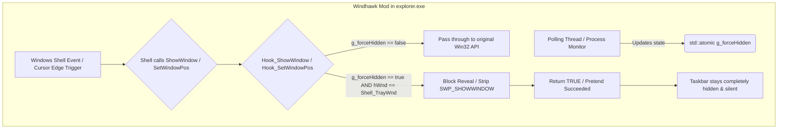

# Architecture & Technical Deep Dive

This document provides an in-depth breakdown of how the **Windows 11 App Specific Taskbar Hider** mod operates inside the Windows Shell (`explorer.exe`), why traditional autohide workarounds fail, and how inline Win32 API hooks achieve zero-latency hover suppression.

---

## 1. The Core Problem with Windows 11 Taskbar Auto-Hide

Windows 11 ships with an internal taskbar auto-hide implementation. However, it suffers from a fundamental design behavior that impairs workflows in creative, production, and gaming environments:

```
+-----------------------------------------------------------+
| Active Application (e.g. DaVinci Resolve / Photoshop)      |
|                                                           |
| Timeline Controls / Bottom Horizontal Scrollbar           |
| [================== Cursor Lands Here ==================] |
+-----------------------------------------------------------+
  |  (Cursor touches bottom screen margin)
  v
[explorer.exe Shell Monitor] ---> Detects cursor near edge
  |
  +---> Unconditionally triggers Slide-In Animation
  +---> Summons `Shell_TrayWnd` to Top of Z-Order
  +---> Intercepts Click / Steals Focus from App!
```

### Why Naive Scripts Fail
Third-party tools and AutoHotkey scripts usually poll the active process and issue `ShowWindow(hWnd, SW_HIDE)`. This fails in practice because:
1. `explorer.exe` runs its own high-priority mouse hook / timer loop.
2. The instant your cursor grazes the bottom edge of the screen, the Shell calls `ShowWindow(hWnd, SW_SHOW)` or `SetWindowPos()` to slide the taskbar back into view.
3. A timer-based script is always in a race condition with the Shell's internal events, resulting in annoying flicker, missed clicks, and focus loss.

---

## 2. The Windhawk Hook Architecture

Rather than fighting `explorer.exe` from an external process, this mod injects directly into `explorer.exe` through [Windhawk](https://windhawk.net/) and hooks the exact Win32 API calls that the Shell uses to reveal and activate the taskbar.



---

## 3. Intercepted Win32 APIs

### A. `ShowWindow(HWND hWnd, int nCmdShow)`
* **Target Window**: `Shell_TrayWnd` (the top-level window class of the Windows taskbar).
* **Behavior when `g_forceHidden` is active**:
  When the Shell tries to execute `SW_SHOW`, `SW_SHOWNA`, `SW_SHOWNORMAL`, `SW_SHOWNOACTIVATE`, or `SW_RESTORE`:
  ```cpp
  if (g_forceHidden && hWnd == g_taskbarHwnd) {
      switch (nCmdShow) {
          case SW_SHOW:
          case SW_SHOWNA:
          case SW_SHOWNORMAL:
          case SW_SHOWNOACTIVATE:
          case SW_RESTORE:
              return TRUE; // Pretend it worked, do nothing
      }
  }
  ```
  The call returns `TRUE` immediately without modifying the window state.

### B. `SetWindowPos(...)`
* Windows often restores or moves the taskbar using `SetWindowPos` instead of `ShowWindow`.
* **Behavior when `g_forceHidden` is active**:
  ```cpp
  if (g_forceHidden && hWnd == g_taskbarHwnd) {
      uFlags &= ~SWP_SHOWWINDOW;
      uFlags |= SWP_NOACTIVATE | SWP_HIDEWINDOW;
  }
  return g_origSetWindowPos(hWnd, hWndInsertAfter, X, Y, cx, cy, uFlags);
  ```
  This strips any show request and enforces `SWP_HIDEWINDOW | SWP_NOACTIVATE`, ensuring the taskbar cannot sneak in through position changes.

### C. `SetForegroundWindow(HWND hWnd)`
* Blocks the taskbar window from taking focus away from the active application while `g_forceHidden` is `true`.

---

## 4. Fullscreen Work Area Expansion (`SPI_SETWORKAREA`)

Simply hiding the taskbar window leaves a gap at the bottom of the screen where maximized windows stop. To grant your application **100% true screen estate**:

```cpp
void AdjustWorkArea(bool useFullScreen) {
    MONITORINFO mi = { sizeof(mi) };
    HMONITOR hMonitor = MonitorFromWindow(NULL, MONITOR_DEFAULTTOPRIMARY);

    if (GetMonitorInfo(hMonitor, &mi)) {
        RECT rcWork = mi.rcMonitor;

        if (!useFullScreen) {
            SystemParametersInfo(SPI_GETWORKAREA, 0, &rcWork, 0);
        } else {
            rcWork = mi.rcMonitor;
            SystemParametersInfo(SPI_SETWORKAREA, 0, &rcWork, SPIF_SENDCHANGE | SPIF_UPDATEINIFILE);
        }
    }
}
```

- When the target app is focused, the desktop work area (`rcWork`) expands to match `rcMonitor`.
- When switching back to desktop or an unlisted app, the original desktop work area is restored.

---

## 5. Thread Safety & Performance

- **Hook Performance**: The API hooks execute in nanoseconds (a pointer check and an atomic boolean comparison). There is **zero measurable CPU overhead** during everyday usage.
- **Process Polling**: A lightweight background thread checks foreground/process state every ~300ms using `QueryFullProcessImageNameW` or snapshot lookups.
- **Locking**: Mod settings are protected by `CRITICAL_SECTION g_settingsLock` to prevent data races during dynamic settings reconfiguration.

