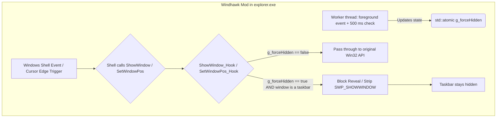

# Architecture & Technical Deep Dive

This document provides an in-depth breakdown of how the **App Specific Taskbar Hider** mod operates inside the Windows Shell (`explorer.exe`), why traditional autohide workarounds fail, and how inline Win32 API hooks achieve zero-latency hover suppression.

---

## 1. The Core Problem with Windows 11 Taskbar Auto-Hide

Windows 11 ships with an internal taskbar auto-hide implementation. However, it suffers from a fundamental design behavior that impairs workflows in creative, production, and gaming environments:

```
+-----------------------------------------------------------+
| Active Application (e.g. DaVinci Resolve / Photoshop)      |
|                                                           |
| Timeline Controls / Bottom Horizontal Scrollbar           |
| [================== Cursor Lands Here ==================] |
+-----------------------------------------------------------+
  |  (Cursor touches bottom screen margin)
  v
[explorer.exe Shell Monitor] ---> Detects cursor near edge
  |
  +---> Unconditionally triggers Slide-In Animation
  +---> Summons `Shell_TrayWnd` to Top of Z-Order
  +---> Intercepts Click / Steals Focus from App!
```

### Why Naive Scripts Fail
Third-party tools and AutoHotkey scripts usually poll the active process and issue `ShowWindow(hWnd, SW_HIDE)`. This fails in practice because:
1. `explorer.exe` runs its own high-priority mouse hook / timer loop.
2. The instant your cursor grazes the bottom edge of the screen, the Shell calls `ShowWindow(hWnd, SW_SHOW)` or `SetWindowPos()` to slide the taskbar back into view.
3. A timer-based script is always in a race condition with the Shell's internal events, resulting in annoying flicker, missed clicks, and focus loss.

---

## 2. The Windhawk Hook Architecture

Rather than fighting `explorer.exe` from an external process, this mod injects directly into `explorer.exe` through [Windhawk](https://windhawk.net/) and hooks the exact Win32 API calls that the Shell uses to reveal and activate the taskbar.




---

## 3. Intercepted Win32 APIs

All hooks check the window class, so they cover the primary taskbar (`Shell_TrayWnd`) and the taskbars on other monitors (`Shell_SecondaryTrayWnd`), including taskbars Windows recreates later.

### A. `ShowWindow(HWND hWnd, int nCmdShow)`
While `g_forceHidden` is active, any call on a taskbar window other than `SW_HIDE` is ignored:
```cpp
if (g_forceHidden && nCmdShow != SW_HIDE && IsTaskbarWindow(hWnd)) {
    return FALSE;  // Previous state: hidden
}
```

### B. `SetWindowPos(...)`
Windows often moves or restores the taskbar using `SetWindowPos` instead of `ShowWindow`:
```cpp
if (g_forceHidden && IsTaskbarWindow(hWnd)) {
    uFlags &= ~SWP_SHOWWINDOW;
    uFlags |= SWP_NOACTIVATE | SWP_HIDEWINDOW;
}
```
This strips any show request, so the taskbar can't become visible through position changes.

### C. `SetForegroundWindow(HWND hWnd)`
Blocks a hidden taskbar from taking the focus away from the active application.

---

## 4. Full Screen Work Area (`SPI_SETWORKAREA`)

Hiding the taskbar window alone leaves a gap at the bottom of the screen where maximized windows stop. When hiding starts, for each monitor that has a taskbar, the mod:

1. Finds the edge of the monitor the taskbar is docked to.
2. Saves the monitor's current work area (only the first time).
3. Extends the work area over that edge with `SPI_SETWORKAREA`, without `SPIF_SENDCHANGE`. Space reserved by other appbars (docks, toolbars) on other edges is kept.
4. Broadcasts `WM_SETTINGCHANGE` once with `SendMessageTimeout(SMTO_ABORTIFHUNG, 100 ms)`, so a hung app can't block the mod. `SPIF_SENDCHANGE` would wait for every top-level window.

While hidden, the work areas are re-checked every second, so a work area reset by a display change, or a newly connected monitor, is extended again. The originally saved work area is kept.

When the taskbar is shown again, or the mod is disabled, the saved work areas are restored. A saved work area is skipped if that monitor no longer exists with the same size, since Windows recalculates the work area after display changes anyway.

---

## 5. Threading & Performance

- **Worker thread**: A single worker thread owns all state changes. It listens for `EVENT_SYSTEM_FOREGROUND`, so switching apps updates the state instantly, and runs a light check every 500 ms (process list in "running" mode, re-hiding a recreated taskbar).
- **Alt+Tab / Task View**: While these shell windows have the focus, the current state is kept, so switching between target apps doesn't flash the taskbar.
- **No deadlocks**: The taskbar windows belong to explorer's UI thread, so the worker thread uses `ShowWindowAsync`, which never waits for that thread. Only taskbars the mod hid itself are shown again.
- **Single owner**: `@include explorer.exe` loads the mod into every Explorer process. Only the process that owns the taskbar acts; the others stay idle.
- **Re-entrancy**: Broadcasting `WM_SETTINGCHANGE` waits for other windows, during which other events can be delivered. Nested updates are deferred until the current update finishes.
- **Hook cost**: While the taskbar isn't hidden, each hook only reads an atomic flag. While hidden, it also checks the window class.
- **Locking**: Settings are protected by `g_settingsLock`, since Windhawk calls `Wh_ModSettingsChanged` on a different thread.
